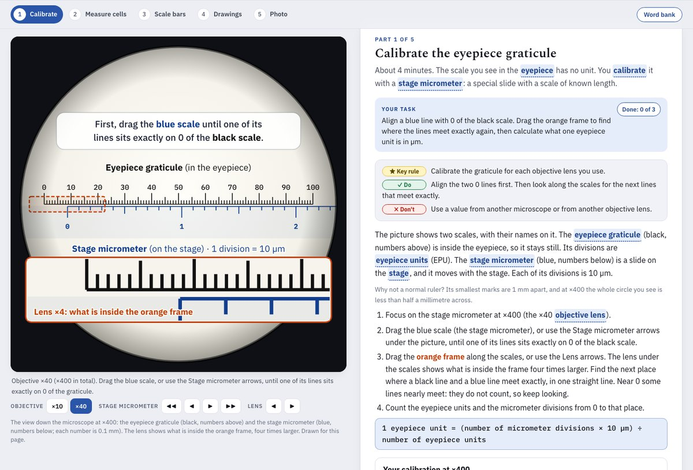

# IB Biology practical: microscopy skills (A2.2.2)

**Live:** https://nlcsbiology.com/A22-microscopy-skills-pract/ (since 18 Oct 2026)

**Where it sits:** a *practical*, listed under the IB toggle of the [Biology Hub](https://nlcsbiology.com/biology-hub/)
(Foundations door), beside the starch and rocky shore practicals.

About **15 minutes** of practice in four microscopy skills, set as homework or done in class. Five parts, as tabs along
the top, with the picture on the left (up to 56 % of the width on a computer) showing what each part is about:

1. **Calibrate the graticule.** Both scales are named on the picture, and the next step is written at its top. Students
   drag the stage micrometer until one of its lines sits on 0 of the eyepiece graticule, then drag an orange frame along
   the scales: a lens shows what is inside it four times larger (28 EPU, so the 0 line and the first exact match fit in
   it together). They find where the lines meet exactly again and calculate one eyepiece unit (EPU) in µm. Then: the
   value at ×100, and why each objective needs its own calibration. A note says why a normal ruler cannot do the job.
2. **Measure cells.** Three cheek cells (A, B, C) at ×400: move the slide, turn the eyepiece along each cell's longest
   axis, count EPU, change to µm, calculate the mean. Then a cell at an angle, and the mean of a row of leaf cells.
3. **Scale bars.** A micrograph as printed on an exam page, with a ruler they drag: the scale bar and a Paramecium in mm,
   then magnification, actual size, and the scale bar for their own drawing. Then an electron micrograph and a units
   mistake.
4. **Drawings.** The rules recalled from memory (SOLD: Size, Outline, Labels, Detail, and a scale; each box shows the first
   letter of its word), then three mistakes
   typed for each of three drawings (each mistake is found by its own words, in any wording, with a letter or two of
   misspelling allowed). Drawing D follows every rule.
5. **The photo.** How to take a photo through the eyepiece with a phone (the eyepiece is labelled on the picture; the
   phone's screen starts out of focus, and a click on the cells focuses it there), and safety, with one quick check.

The practice specimens are human cheek cells (no longer done in the school lab, for health and safety) and a leaf
epidermis peel with guard cells (done in Year 8 and Year 11).

Keywords are tinted and bold: press one and its meaning opens under the line. Every word and number is typed, never
chosen from a list; multiple choice is drawn in a new order each time; the answers appear only after two tries; every
answer survives a reload. IB Biology guide (2025): A2.2.2; Tool 1 (a light microscope and eyepiece graticule) and Tool 3
(actual size from a micrograph with a scale bar). Textbook: Allott and Mindorff, Oxford IB Biology Course Companion
(2023), pp. 50–55.

## For the teacher: how each student is doing
A student who signs in with their school Google account (the line under the title; the same sign-in as the Biology Hub)
has every Check, every choice and every ↺ Start again kept for their teacher, question by question. The teacher sees it on
the teacher page's **🔬 Practicals** tab: one square per question for each student (15 questions), the questions the class
finds hardest, and **● Live** during the lesson. It is not homework and not a mark. Signed out, the page works exactly the
same and nothing leaves the browser.

The `tools/` named here stay on Daniel's computer: they are not in this repository (since 18 Oct 2026).

Behind it: `js/lesson.js` and `js/signin.js` are copies of `labs-shared/` (made by `tools/practicals-sync.mjs` in the
workspace), `js/config.js` names this practical, and `data/questions.json` lists its questions for the board
(`node tools/make-questions.mjs` writes it from the page; `--check` says when it is out of date). Keep a question's id
when you reword it, or its students' records move to a new square.

## The numbers behind the pictures
One microscope for the whole page: at ×400, 17 eyepiece units match 4 stage-micrometer divisions (40 µm), so
1 EPU = 2.35 µm; at ×100 it is 9.41 µm (17 EPU = 16 divisions). The exact matches are at 17, 34, 51, 68 and 85 EPU, and
any of them is accepted. Cheek cells A, B and C are drawn 62, 55 and 70 µm long at their longest (26.4, 23.4 and 29.8
EPU); a reading within 1.5 EPU is accepted, and each length in µm and the mean are checked against the student's own
readings. The leaf cells are 80.7 µm long, so a row of 7 fills 60 EPU at ×100. On the printed page 1 mm = 4 drawing
units: the Paramecium is 88 mm long and its 50 µm bar is 20 mm, so ×400 and 220 µm. Every picture is drawn in SVG by
`js/scope.js` from these numbers, so a measurement on the screen gives the answer the page expects.

## Behind the scenes
`index.html` (the parts and their words), `css/app.css` (the rocky shore practical's sheet in this page's colour,
methylene blue, plus the microscope, ruler, drawings and phone), `js/scope.js` (every picture), `js/app.js` (tabs, the
picture's drag and buttons, quick checks, typed sets, the lesson record), `js/practice.js` (the questions, with their
board ids). Bump every `?v=` in `index.html` and `version.txt` after a change.

## Licences
Code: AGPL-3.0 (`LICENSE`). Teaching material, including the questions and the pictures, which are all drawn for this
page: CC BY-NC-SA 4.0 (`LICENSE-CONTENT`): free for teaching, not for selling. See `NOTICE`.
